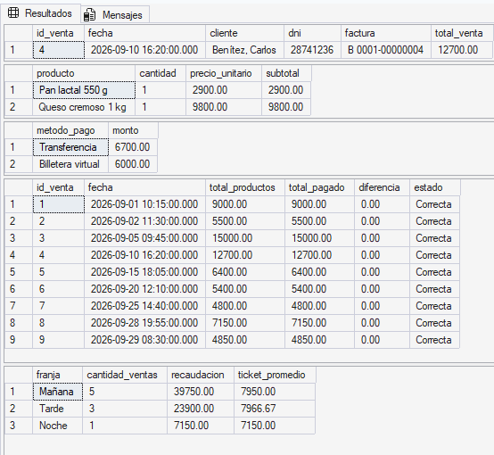
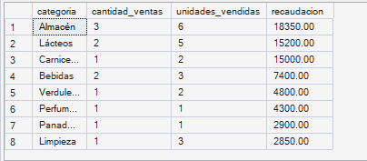
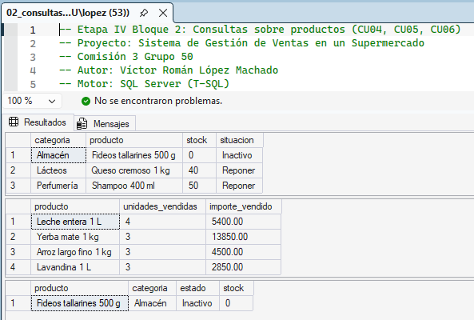
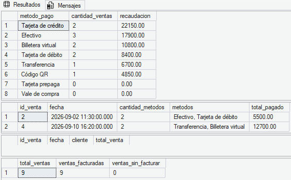
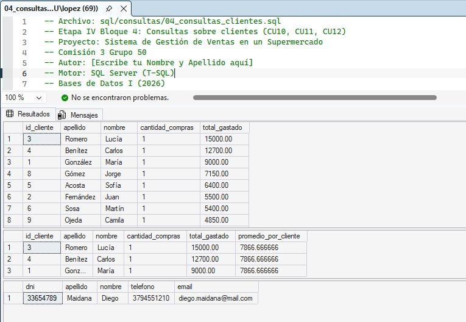
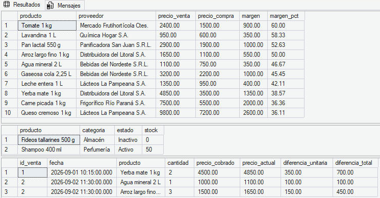

# Etapa IV — Consultas

**¿Cómo obtenemos información?**

En esta etapa usamos la base `supermercado` de la Etapa III para responder preguntas reales del negocio. Cada pregunta es un **caso de uso (CU)**: alguien del supermercado necesita un dato, y lo obtenemos con una consulta `SELECT` en SQL Server.

Algunos datos no se guardan en ninguna tabla y solo se pueden obtener por consulta. El ejemplo principal es el **total de una venta**: es un atributo derivado (suma de los subtotales del detalle), por eso no está en la tabla `venta` y lo calcula el CU01.

## Orden de ejecución

Primero se ejecutan los scripts de la Etapa III (ver `docs/etapa-03/README.md`), con la corrección de proveedores de `sql/dml/02_carga_ventas.sql`. Después, los scripts de consultas se pueden correr en cualquier orden:

| Bloque | Responsable | Script | Casos de uso | Captura |
|---|---|---|---|---|
| 1. Ventas | Ramiro Yunes | `sql/consultas/01_consultas_ventas.sql` | CU01, CU02, CU03, CU16 | `cu01-cu03-resultado.png`, `cu16-resultado.png` |
| 2. Productos | Víctor López Machado | `sql/consultas/02_consultas_productos.sql` | CU04, CU05, CU06 | `cu04_cu05_cu06.png` |
| 3. Pagos y facturación | Joaquín Valenzuela | `sql/consultas/03_consultas_pagos.sql` | CU07, CU08, CU09 | `cu07-cu09-resultado.png` |
| 4. Clientes | Hernán Vargas | `sql/consultas/04_consultas_clientes.sql` | CU10, CU11, CU12 | `cu10-cu12-resultados.jpeg` |
| 5. Proveedores y precios | Luciano Aquino | `sql/consultas/05_consultas_proveedores.sql` | CU13, CU14, CU15 | `cu13-cu15-resultado.png` |

## Cómo se cubre lo pedido por la cátedra

| Necesidad de información | Caso de uso | Cómo lo resuelve |
|---|---|---|
| **Factura / Comprobante:** encabezado y detalle de una venta, con subtotal por renglón y total | **CU01** | Cabecera con cliente, factura y total (`SUM` de subtotales), renglones con su subtotal y forma de pago |
| **Reporte agregado:** total de ventas por categoría en un rango de fechas (`GROUP BY`, `SUM`, `COUNT`) | **CU16** | Ventas, unidades y recaudación por categoría entre `@desde` y `@hasta` |
| **Consulta de negocio avanzada:** 3 tablas o más con JOIN y `HAVING` o subconsultas | **CU02, CU08, CU11, CU13** | CU02: subconsultas en `FROM` · CU08: `HAVING` · CU11: `HAVING` con subconsulta · CU13: subconsulta correlacionada |

No hay consultas por vendedor porque el modelo implementado en la Etapa III no tiene tabla de empleados; por eso el reporte agregado se hizo por categoría de producto.

## Resumen de casos de uso

| CU | Necesidad | Regla | Técnica SQL |
|---|---|---|---|
| CU01 | Ticket de una venta con su total | RN05, RN06 | JOIN de varias tablas, `SUM`, `LEFT JOIN` |
| CU02 | Control: total de productos vs. total pagado | RN05, RN06 | Subconsultas en `FROM`, `CASE` |
| CU03 | Recaudación por franja horaria | RN05 | Tabla derivada, `DATEPART`, `GROUP BY` |
| CU04 | Stock bajo e inactivos, por categoría | RN03 | `WHERE`, `CASE` |
| CU05 | Productos más vendidos | RN05 | `TOP n WITH TIES` |
| CU06 | Productos nunca vendidos | RN01, RN05 | `NOT EXISTS` |
| CU07 | Recaudación por método de pago | RN06 | `LEFT JOIN`, `ISNULL`, `COUNT(columna)` |
| CU08 | Ventas con pago mixto | RN06 | JOIN de 3 tablas, `HAVING COUNT(*) > 1`, `STRING_AGG` |
| CU09 | Ventas sin facturar | RN08 | `LEFT JOIN … IS NULL` |
| CU10 | Gasto total por cliente | RN04 | JOIN, `GROUP BY`, `COUNT(DISTINCT)` |
| CU11 | Clientes que gastan más que el promedio | RN04 | JOIN de 3 tablas, `HAVING` con subconsulta |
| CU12 | Clientes sin compras | RN04 | `NOT EXISTS` |
| CU13 | Margen entre precio de venta y de compra | RN02 | JOIN de 3 tablas, subconsulta correlacionada |
| CU14 | Productos sin proveedor asignado | RN02 | `LEFT JOIN … IS NULL` |
| CU15 | Ventas cobradas a un precio distinto del actual | RN05 | Comparación entre tablas |
| CU16 | Ventas por categoría en un período | RN01, RN05 | JOIN de 4 tablas, `GROUP BY`, `SUM`, `COUNT(DISTINCT)` |

---

## Bloque 1 — Ventas (Ramiro Yunes)

### CU01 — Ticket de una venta

| | |
|---|---|
| **Actor** | Cajero / atención al cliente |
| **Objetivo** | Reconstruir el comprobante de una venta: cabecera, productos y forma de pago |
| **Regla** | RN05 (detalle de las ventas) · RN06 (métodos de pago) |
| **Tablas** | `venta`, `cliente`, `detalle_venta`, `producto`, `factura`, `venta_pago`, `metodo_pago` |

Se divide en tres consultas que usan la misma variable `@id_venta`:

- **1.a Cabecera:** une la venta con el cliente y el detalle, y suma los subtotales para obtener el total. Con la factura se usa `LEFT JOIN`, porque una venta puede no estar facturada (RN08); en ese caso muestra *Sin facturar*.
- **1.b Renglones:** muestra el `precio_unitario` guardado en el detalle, que es el precio del día de la venta, no el precio actual del producto.
- **1.c Forma de pago:** lista los métodos usados, que pueden ser más de uno.

**Resultado con `@id_venta = 4`:**

| id_venta | fecha | cliente | dni | factura | total_venta |
|---|---|---|---|---|---|
| 4 | 2026-09-10 16:20 | Benítez, Carlos | 28741236 | B 0001-00000004 | 12700.00 |

| producto | cantidad | precio_unitario | subtotal |
|---|---|---|---|
| Pan lactal 550 g | 1 | 2900.00 | 2900.00 |
| Queso cremoso 1 kg | 1 | 9800.00 | 9800.00 |

| metodo_pago | monto |
|---|---|
| Transferencia | 6700.00 |
| Billetera virtual | 6000.00 |

### CU02 — Control de cobro

| | |
|---|---|
| **Actor** | Encargado de caja / administración |
| **Objetivo** | Verificar en cada venta que lo cobrado coincida con lo vendido |
| **Regla** | RN05 · RN06 |
| **Tablas** | `venta`, `detalle_venta`, `venta_pago` |

El total de productos y el total pagado se calculan **cada uno en su propia subconsulta** (tabla derivada) y recién después se unen con la venta. Si se uniera `venta` directamente con `detalle_venta` y con `venta_pago`, cada renglón del detalle se repetiría por cada pago y las sumas saldrían infladas: la venta 2, que tiene 2 productos y 2 pagos, daría 11000 en vez de 5500.

Un `CASE` clasifica cada venta como *Correcta*, *Pago incompleto* o *Pago en exceso*, y el orden deja los problemas arriba.

**Resultado:** las 9 ventas dan *Correcta* con diferencia 0. Es lo esperado, porque los datos de prueba se cargaron consistentes; si alguna vez se registra un pago mal, la consulta lo muestra primero.

### CU03 — Recaudación por franja horaria

| | |
|---|---|
| **Actor** | Encargado / dueño |
| **Objetivo** | Saber en qué momento del día se vende más, para organizar turnos y cajas |
| **Regla** | RN05 |
| **Tablas** | `venta`, `detalle_venta` |

Franjas: **Mañana** (antes de las 13 h), **Tarde** (de 13 a 19 h) y **Noche** (desde las 19 h). El período se elige con `@desde` y `@hasta`.

Se resuelve en dos pasos. La tabla derivada calcula el total de cada venta y le asigna su franja con `CASE` y `DATEPART(HOUR, …)`. La consulta exterior agrupa por franja. Hace falta la tabla derivada porque el alias `franja` no se puede usar en el `GROUP BY` de la misma consulta: según el orden lógico de procesamiento, `GROUP BY` se ejecuta antes que `SELECT`.

**Resultado para septiembre de 2026:**

| franja | cantidad_ventas | recaudacion | ticket_promedio |
|---|---|---|---|
| Mañana | 5 | 39750.00 | 7950.00 |
| Tarde | 3 | 23900.00 | 7966.67 |
| Noche | 1 | 7150.00 | 7150.00 |

La suma de las tres franjas (70800) coincide con el total de las 9 ventas.

### Ejecución del Bloque 1

Resultados de `01_consultas_ventas.sql` en SQL Server Express (CU01, CU02 y CU03):

### CU16 — Ventas por categoría en un período

| | |
|---|---|
| **Actor** | Encargado / dueño |
| **Objetivo** | Saber qué rubros venden más en un rango de fechas |
| **Regla** | RN01 (productos y categorías) · RN05 |
| **Tablas** | `venta`, `detalle_venta`, `producto`, `categoria` |

Une cuatro tablas, filtra las ventas del período con `@desde` y `@hasta`, y agrupa por categoría. Se cuentan las ventas con `COUNT(DISTINCT v.id_venta)`: si una venta tiene dos productos de la misma categoría aparece en dos renglones del detalle, y sin `DISTINCT` se contaría dos veces. Las categorías sin ventas en el período no aparecen.

**Resultado para septiembre de 2026:**

| categoria | cantidad_ventas | unidades_vendidas | recaudacion |
|---|---|---|---|
| Almacén | 3 | 6 | 18350.00 |
| Lácteos | 2 | 5 | 15200.00 |
| Carnicería | 1 | 2 | 15000.00 |
| Bebidas | 2 | 3 | 7400.00 |
| Verdulería | 1 | 2 | 4800.00 |
| Perfumería | 1 | 1 | 4300.00 |
| Panadería | 1 | 1 | 2900.00 |
| Limpieza | 1 | 3 | 2850.00 |

La suma de la recaudación (70800) coincide con el total de las 9 ventas.

---

## Bloque 2 — Productos (Víctor López Machado)

### CU04 — Stock bajo e inactivos

| | |
|---|---|
| **Actor** | Repositor / encargado de depósito |
| **Objetivo** | Saber qué productos hay que reponer o revisar |
| **Regla** | RN03 (gestión de stock) |
| **Tablas** | `producto`, `categoria` |

Muestra los productos con 50 unidades o menos (`@stock_minimo`) o que están inactivos. Un `CASE` les asigna una situación: *Inactivo*, *Sin stock* o *Reponer*. El orden de los `WHEN` importa: se evalúan de arriba hacia abajo, por eso *Inactivo* va primero (los fideos tienen stock 0 pero están dados de baja).

**Resultado:**

| categoria | producto | stock | situacion |
|---|---|---|---|
| Almacén | Fideos tallarines 500 g | 0 | Inactivo |
| Lácteos | Queso cremoso 1 kg | 40 | Reponer |
| Perfumería | Shampoo 400 ml | 50 | Reponer |

### CU05 — Productos más vendidos

| | |
|---|---|
| **Actor** | Encargado / dueño |
| **Objetivo** | Conocer los 3 productos que más unidades vendieron |
| **Regla** | RN05 |
| **Tablas** | `detalle_venta`, `producto` |

Agrupa el detalle por producto, suma unidades e importe, y usa `TOP 3 WITH TIES` ordenado por unidades. Devuelve **4 filas** aunque se pidió TOP 3, porque hay tres productos empatados con 3 unidades: eso es lo que hace `WITH TIES`.

**Resultado:**

| producto | unidades_vendidas | importe_vendido |
|---|---|---|
| Leche entera 1 L | 4 | 5400.00 |
| Yerba mate 1 kg | 3 | 13850.00 |
| Arroz largo fino 1 kg | 3 | 4500.00 |
| Lavandina 1 L | 3 | 2850.00 |

### CU06 — Productos nunca vendidos

| | |
|---|---|
| **Actor** | Encargado / dueño |
| **Objetivo** | Detectar productos del catálogo que no aparecen en ninguna venta |
| **Regla** | RN01 · RN05 |
| **Tablas** | `producto`, `categoria`, `detalle_venta` |

Usa `NOT EXISTS` con una subconsulta correlacionada (`d.id_producto = p.id_producto`). Sin esa condición, como hay ventas, el `NOT EXISTS` siempre daría falso y no devolvería nada.

**Resultado:**

| producto | categoria | estado | stock |
|---|---|---|---|
| Fideos tallarines 500 g | Almacén | Inactivo | 0 |

### Ejecución del Bloque 2

---

## Bloque 3 — Pagos y facturación (Joaquín Valenzuela)

### CU07 — Recaudación por método de pago

| | |
|---|---|
| **Actor** | Encargado de caja / administración |
| **Objetivo** | Saber cuánto se cobró con cada forma de pago, incluidos los métodos que no se usaron |
| **Regla** | RN06 (métodos de pago) |
| **Tablas** | `metodo_pago`, `venta_pago` |

Se parte de `metodo_pago` y se hace `LEFT JOIN` con `venta_pago`, así los métodos sin pagos no desaparecen. Se cuenta con `COUNT(vp.id_venta)` y no con `COUNT(*)`: con LEFT JOIN, un método sin uso trae una fila con NULL y `COUNT(*)` la contaría como 1. `ISNULL(SUM(...), 0)` muestra 0 en vez de NULL.

**Resultado:** 8 métodos. El que más recaudó es tarjeta de crédito (22.150); vale de compra y tarjeta prepaga aparecen con 0. La suma total (70.800) coincide con el total de las ventas.

| metodo_pago | cantidad_ventas | recaudacion |
|---|---|---|
| Tarjeta de crédito | 2 | 22150.00 |
| Efectivo | 3 | 17900.00 |
| Billetera virtual | 2 | 10800.00 |
| Tarjeta de débito | 2 | 8400.00 |
| Transferencia | 1 | 6700.00 |
| Código QR | 1 | 4850.00 |
| Tarjeta prepaga | 0 | 0.00 |
| Vale de compra | 0 | 0.00 |

### CU08 — Ventas con pago mixto

| | |
|---|---|
| **Actor** | Encargado de caja |
| **Objetivo** | Identificar las ventas que se pagaron con más de un método |
| **Regla** | RN06 |
| **Tablas** | `venta`, `venta_pago`, `metodo_pago` |

Se agrupa por venta y se filtra con `HAVING COUNT(*) > 1`. El filtro va en `HAVING` y no en `WHERE`, porque `WHERE` se ejecuta antes de agrupar y no puede usar `COUNT`. `STRING_AGG` junta los nombres de los métodos en una sola columna. Es una consulta de 3 tablas con JOIN y HAVING.

**Resultado:**

| id_venta | fecha | cantidad_metodos | metodos | total_pagado |
|---|---|---|---|---|
| 2 | 2026-09-02 11:30 | 2 | Efectivo, Tarjeta de débito | 5500.00 |
| 4 | 2026-09-10 16:20 | 2 | Transferencia, Billetera virtual | 12700.00 |

### CU09 — Ventas sin facturar

| | |
|---|---|
| **Actor** | Administración |
| **Objetivo** | Detectar las ventas que todavía no tienen factura emitida |
| **Regla** | RN08 (facturación) |
| **Tablas** | `venta`, `cliente`, `detalle_venta`, `factura` |

Con `LEFT JOIN` a `factura` se conservan todas las ventas, y las que no tienen factura se filtran con `WHERE f.id_factura IS NULL`. Se usa `IS NULL` y no `= NULL`: comparar con NULL da desconocido y la consulta devolvería 0 filas sin dar error.

**Resultado:** la consulta 9.a devuelve **0 filas**, porque las 9 ventas cargadas tienen su factura. Para que se vea el estado general se agregó el control 9.b:

| total_ventas | ventas_facturadas | ventas_sin_facturar |
|---|---|---|
| 9 | 9 | 0 |

Si se registra una venta nueva sin emitir su factura, la 9.a la muestra con su cliente e importe a facturar.

### Ejecución del Bloque 3

Resultados de `03_consultas_pagos.sql` en SQL Server (CU07, CU08 y CU09):

---

## Bloque 4 — Clientes (Hernán Vargas)

### CU10 — Gasto total por cliente

| | |
|---|---|
| **Actor** | Encargado / área comercial |
| **Objetivo** | Saber cuántas compras hizo y cuánto gastó cada cliente |
| **Regla** | RN04 (registro de clientes) |
| **Tablas** | `cliente`, `venta`, `detalle_venta` |

Une las tres tablas y agrupa por cliente. Las compras se cuentan con `COUNT(DISTINCT v.id_venta)`: al unir con el detalle, cada venta aparece una vez por renglón, y con `COUNT(*)` a los clientes con ventas de dos productos les daría 2 compras en lugar de 1.

**Resultado:** 9 clientes con una compra cada uno, de Romero Lucía (15000) a Ramírez Valentina (4800).

### CU11 — Clientes que gastan más que el promedio

| | |
|---|---|
| **Actor** | Dueño / área comercial |
| **Objetivo** | Identificar los clientes que gastaron más que el promedio de gasto por cliente |
| **Regla** | RN04 |
| **Tablas** | `cliente`, `venta`, `detalle_venta` |

Parte de la consulta del CU10 y agrega `HAVING SUM(d.subtotal) > (subconsulta)`. La subconsulta calcula el promedio **del gasto por cliente** con una tabla derivada (70800 / 9 = 7866,67). Si se hiciera `AVG(d.subtotal)` directo, se promediarían los 12 renglones del detalle (5900) y aparecerían clientes de más. Es una consulta de 3 tablas con JOIN, `HAVING` y subconsulta.

**Resultado:**

| cliente | total_gastado | promedio_por_cliente |
|---|---|---|
| Romero, Lucía | 15000.00 | 7866.67 |
| Benítez, Carlos | 12700.00 | 7866.67 |
| González, María | 9000.00 | 7866.67 |

### CU12 — Clientes sin compras

| | |
|---|---|
| **Actor** | Área comercial |
| **Objetivo** | Encontrar clientes registrados que nunca compraron, para contactarlos |
| **Regla** | RN04 |
| **Tablas** | `cliente`, `venta` |

Usa `NOT EXISTS` con una subconsulta correlacionada sobre `venta`. Muestra los datos de contacto del cliente.

**Resultado:**

| dni | cliente | telefono | email |
|---|---|---|---|
| 33654789 | Maidana, Diego | 3794551210 | diego.maidana@mail.com |

### Ejecución del Bloque 4

---

## Bloque 5 — Proveedores y precios (Luciano Aquino)

### CU13 — Margen de ganancia por producto

| | |
|---|---|
| **Actor** | Dueño / encargado de compras |
| **Objetivo** | Saber cuánto se gana con cada producto, comparando el precio de venta con el precio de compra |
| **Regla** | RN02 (gestión de proveedores) |
| **Tablas** | `producto`, `producto_proveedor`, `proveedor` |

Se une cada producto con su compra al proveedor y se calcula la diferencia entre el precio de venta y el de compra, en pesos y en porcentaje sobre el costo. Para el porcentaje se multiplica por 100 antes de dividir, así no se pierden decimales. Como un producto puede comprarse varias veces a distinto precio, una subconsulta correlacionada se queda solo con la compra más reciente de cada producto (`MAX(fecha_compra)`). Es una consulta de 3 tablas con JOIN y subconsulta.

**Resultado:** 10 productos (todos los que tienen proveedor). El de mayor margen es el tomate (60 %) y el de menor, el queso cremoso (36,11 %).

| producto | proveedor | precio_venta | precio_compra | margen | margen_pct |
|---|---|---|---|---|---|
| Tomate 1 kg | Mercado Frutihortícola Ctes. | 2400.00 | 1500.00 | 900.00 | 60.00 |
| Lavandina 1 L | Química Hogar S.A. | 950.00 | 600.00 | 350.00 | 58.33 |
| Pan lactal 550 g | Panificadora San Juan S.R.L. | 2900.00 | 1900.00 | 1000.00 | 52.63 |
| Arroz largo fino 1 kg | Distribuidora del Litoral S.A. | 1650.00 | 1100.00 | 550.00 | 50.00 |
| Agua mineral 2 L | Bebidas del Nordeste S.R.L. | 1100.00 | 750.00 | 350.00 | 46.67 |
| Gaseosa cola 2,25 L | Bebidas del Nordeste S.R.L. | 3200.00 | 2200.00 | 1000.00 | 45.45 |
| Leche entera 1 L | Lácteos La Pampeana S.A. | 1350.00 | 950.00 | 400.00 | 42.11 |
| Yerba mate 1 kg | Distribuidora del Litoral S.A. | 4850.00 | 3500.00 | 1350.00 | 38.57 |
| Carne picada 1 kg | Frigorífico Río Paraná S.A. | 7500.00 | 5500.00 | 2000.00 | 36.36 |
| Queso cremoso 1 kg | Lácteos La Pampeana S.A. | 9800.00 | 7200.00 | 2600.00 | 36.11 |

### CU14 — Productos sin proveedor asignado

| | |
|---|---|
| **Actor** | Encargado de compras |
| **Objetivo** | Detectar productos sin ningún proveedor cargado (no se sabe a quién pedirlos) |
| **Regla** | RN02 |
| **Tablas** | `producto`, `categoria`, `producto_proveedor` |

Se usa `LEFT JOIN` con `producto_proveedor` para no perder los productos que no tienen proveedor, y después se filtran con `WHERE pp.id_producto IS NULL`. Se compara con `IS NULL` y no con `= NULL`, porque cualquier comparación con NULL da desconocido y la consulta no devolvería filas.

**Resultado:**

| producto | categoria | estado | stock |
|---|---|---|---|
| Fideos tallarines 500 g | Almacén | Inactivo | 0 |
| Shampoo 400 ml | Perfumería | Activo | 50 |

El shampoo es el caso importante: está activo y se vende, pero no tiene a quién pedírselo.

### CU15 — Ventas cobradas a un precio distinto del actual

| | |
|---|---|
| **Actor** | Dueño / administración |
| **Objetivo** | Encontrar los renglones de venta cobrados a un precio distinto del precio actual del producto |
| **Regla** | RN05 (detalle de las ventas) |
| **Tablas** | `venta`, `detalle_venta`, `producto` |

Se compara el precio guardado en el detalle (`precio_unitario`, el del día de la venta) con el precio actual del producto. Esta consulta muestra por qué el detalle guarda su propio precio: si se usara el precio de hoy, la venta 1 pasaría a valer 9700 en vez de los 9000 que realmente se cobraron.

**Resultado:**

| id_venta | fecha | producto | cantidad | precio_cobrado | precio_actual | diferencia_unitaria | diferencia_total |
|---|---|---|---|---|---|---|---|
| 1 | 2026-09-01 10:15 | Yerba mate 1 kg | 2 | 4500.00 | 4850.00 | 350.00 | 700.00 |
| 2 | 2026-09-02 11:30 | Agua mineral 2 L | 1 | 1000.00 | 1100.00 | 100.00 | 100.00 |
| 2 | 2026-09-02 11:30 | Arroz largo fino 1 kg | 3 | 1500.00 | 1650.00 | 150.00 | 450.00 |

### Ejecución del Bloque 5

Resultados de `05_consultas_proveedores.sql` en SQL Server (CU13, CU14 y CU15):

