# Etapa V — Temas técnicos

**¿Cómo hacemos la solución más robusta?**

En esta etapa usamos mecanismos del motor de SQL Server Express sobre la base `supermercado` de la Etapa III: procedimientos y funciones almacenadas, transacciones, triggers de auditoría, permisos y roles, e índices. Para cada tema se documenta para qué sirve, por qué lo elegimos, cómo se integra al sistema y cómo se demuestra que funciona.

## Orden de ejecución

Primero se ejecutan los scripts de la Etapa III (ver `docs/etapa-03/README.md`). Después, los de `sql/tecnico/` en orden, porque el tema 4 usa el procedimiento de inserción del tema 1:

| Tema | Script | Capturas |
|---|---|---|
| 1. Procedimientos y funciones almacenadas | `sql/tecnico/01_procedimientos_funciones.sql` | `t1-*.png` |
| 2. Manejo de transacciones | `sql/tecnico/02_transacciones.sql` | `t2-*.png` |
| 3. Triggers de auditoría | `sql/tecnico/03_triggers.sql` | `t3-*.png` |
| 4. Seguridad: permisos de usuarios y roles | `sql/tecnico/04_seguridad.sql` | `t4-*.png` |
| 5. Optimización de consultas con índices | `sql/tecnico/05_indices.sql` | `t5-*.png` |

---

## Tema 1 — Procedimientos y funciones almacenadas (Ramiro Yunes)

### 1. Definición y objetivo

Un **procedimiento almacenado** es un conjunto de sentencias SQL guardado dentro de la base con un nombre. Recibe parámetros, puede hacer `INSERT`, `UPDATE` y `DELETE`, y se ejecuta con `EXEC`.

Una **función almacenada** recibe parámetros y devuelve un resultado: un valor (función escalar) o una tabla (función con valor de tabla). **No puede modificar datos**, y por eso se puede usar dentro de un `SELECT`, en el `WHERE` o en el `FROM`.

El objetivo es escribir una sola vez la lógica que se repite (dar de alta un cliente, calcular el total de una venta) y que toda la aplicación la use de la misma forma.

### 2. Ventajas y aplicaciones

- **Reutilización:** la lógica se escribe una vez y se llama desde cualquier lado.
- **Reglas de negocio centralizadas:** por ejemplo, «un cliente con compras no se borra» queda dentro del procedimiento y no depende de quien escriba el `DELETE`.
- **Seguridad:** se puede dar permiso para ejecutar un procedimiento sin dar permiso sobre la tabla (es lo que se demuestra en el tema 4).
- **Mantenimiento:** si cambia la regla, se cambia en un solo lugar.
- **Funciones para datos derivados:** el total de una venta no se guarda en ninguna tabla (es un atributo derivado); una función lo calcula siempre igual.

### 3. Implementación en SQL Server Express

Script: `sql/tecnico/01_procedimientos_funciones.sql`.

| Objeto | Tipo | Qué hace |
|---|---|---|
| `dbo.sp_cliente_insertar` | Procedimiento | Da de alta un cliente. Rechaza un DNI repetido con un mensaje propio (error 50001) y devuelve el id generado en un parámetro `OUTPUT` |
| `dbo.sp_cliente_modificar` | Procedimiento | Cambia nombre, apellido, teléfono y email de un cliente. Si el id no existe, error 50002 |
| `dbo.sp_cliente_borrar` | Procedimiento | Borra un cliente. Si tiene ventas no lo deja borrar (error 50003) |
| `dbo.fn_total_venta(@id_venta)` | Función escalar | Total de una venta: suma de los subtotales de `detalle_venta` |
| `dbo.fn_descuento_cliente(@id_cliente)` | Función escalar | Porcentaje de descuento según lo que compró el cliente |
| `dbo.fn_productos_categoria(@id_categoria)` | Función con valor de tabla | Productos de una categoría con sus unidades vendidas |

Elegimos la tabla **`cliente`** para los procedimientos porque los clientes nuevos no tienen ventas: se pueden insertar, modificar y borrar sin chocar con la FK de `venta`.

La función de descuento se basa en el ejemplo de la guía de la cátedra. Los montos se adaptaron a la escala de nuestros datos de prueba, porque con los de la guía (500.000 y 200.000) ningún cliente tendría descuento:

| Total acumulado del cliente | Descuento |
|---|---|
| 12.000 o más | 10 % |
| 8.000 o más | 5 % |
| Menos de 8.000 | 0 % |

El script se puede ejecutar más de una vez: los objetos se crean con `CREATE OR ALTER`, y al principio se borran los clientes de prueba (DNI que empiezan con 5).

### 4. Caso concreto en el supermercado

- En la caja se da de alta un cliente nuevo con `sp_cliente_insertar`. Si el DNI ya estaba cargado, el sistema avisa en vez de mostrar un error técnico de SQL.
- Atención al cliente actualiza teléfono y email con `sp_cliente_modificar`.
- Si alguien intenta borrar un cliente que ya compró, `sp_cliente_borrar` lo impide: sus ventas y facturas tienen que quedar en el historial.
- Para el ticket o cualquier reporte, `fn_total_venta` da el total de una venta. Es el mismo cálculo que hicimos con `SUM` en el CU01 de la Etapa IV.
- `fn_descuento_cliente` dice qué descuento le corresponde a un cliente frecuente.
- `fn_productos_categoria` sirve para ver una góndola: qué productos hay en la categoría, su stock y cuánto se vendió.

### 5. Demostración y resultados

**Objetos creados.** En el Explorador de objetos aparecen los 3 procedimientos, las 2 funciones escalares y la función con valor de tabla.

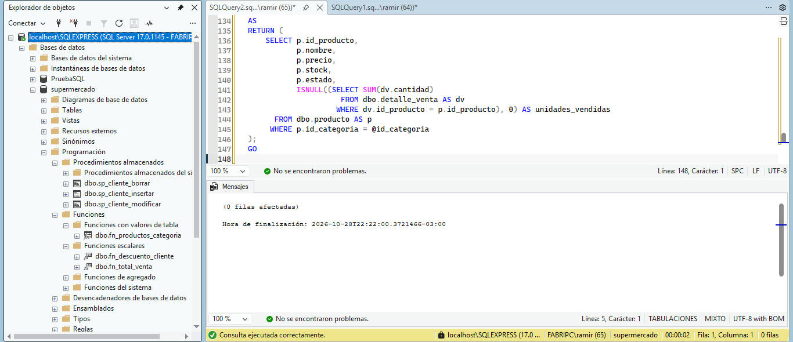

**Lote con `INSERT` directo.** Cinco clientes cargados con una sentencia `INSERT` (ids 11 a 15).

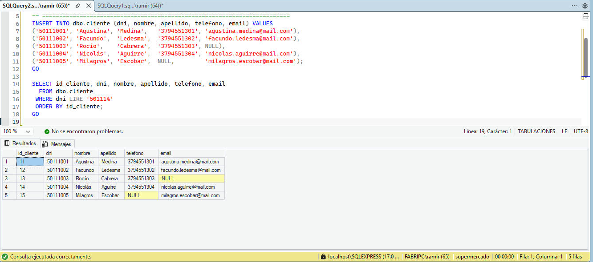

**Lote invocando el procedimiento.** Otros cinco clientes cargados con `EXEC dbo.sp_cliente_insertar` (ids 16 a 20). Cada llamada devuelve el id generado. Al final se intenta cargar un DNI repetido y el procedimiento lo rechaza con el error 50001.

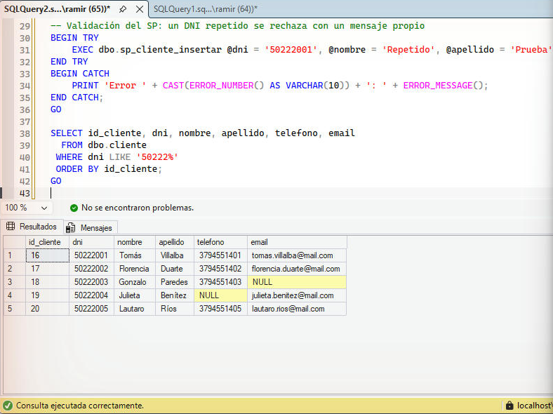

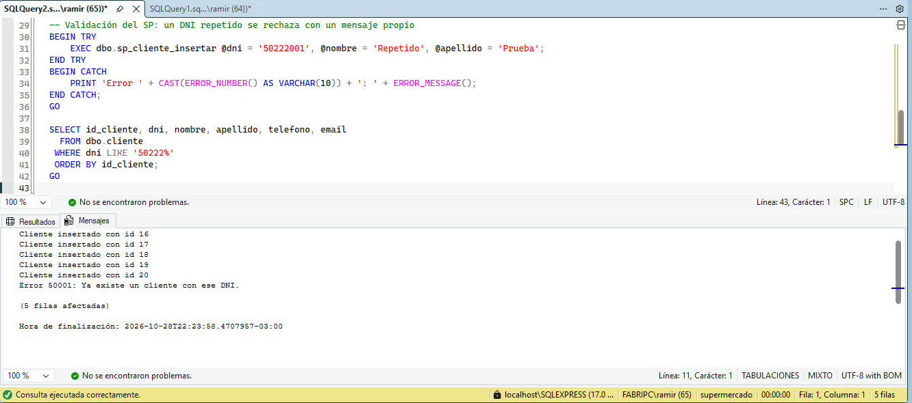

**`UPDATE` y `DELETE` con los procedimientos.** Antes y después: a Rocío Cabrera (13) y a Gonzalo Paredes (18) se les completaron los datos de contacto, y Milagros Escobar (15) y Julieta Benítez (19) se borraron. Después se intenta borrar al cliente 1, que tiene ventas, y el procedimiento lo impide con el error 50003.

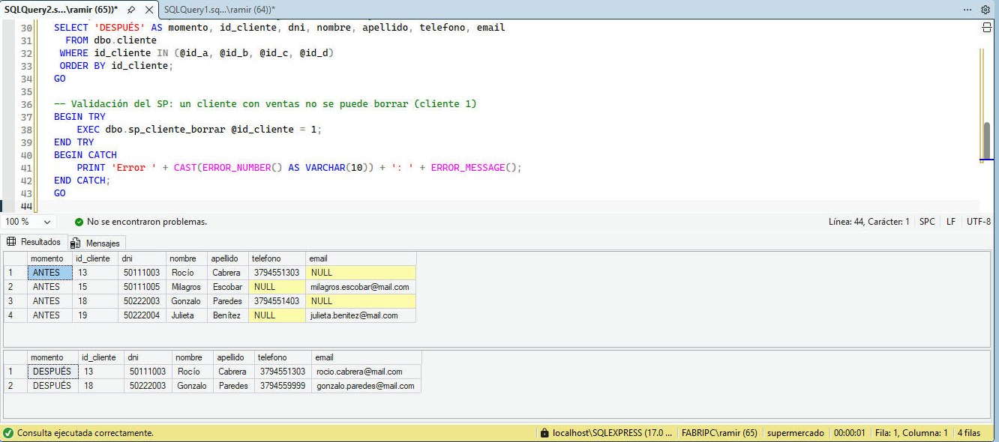

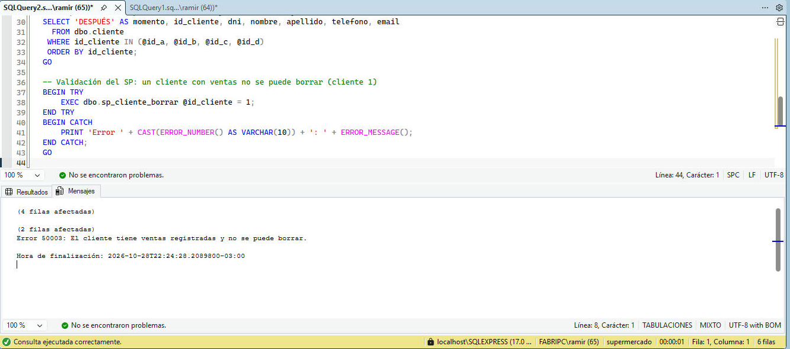

**Función `fn_total_venta`.** Total de las 9 ventas. La suma da 70.800, igual que en la Etapa IV.

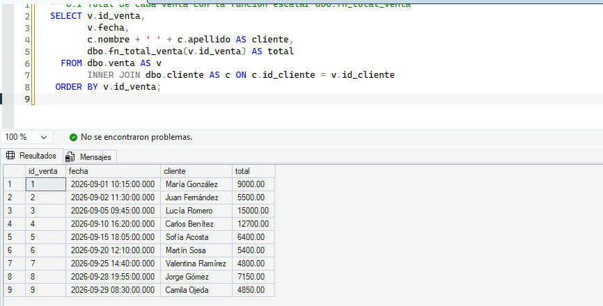

**Función `fn_descuento_cliente`.** Lucía Romero (15.000) y Carlos Benítez (12.700) tienen 10 %, María González (9.000) tiene 5 % y el resto 0 %.

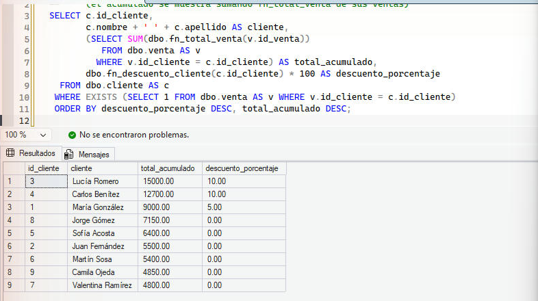

**Función `fn_productos_categoria`.** Se usa en el `FROM` como si fuera una tabla, con la categoría 1 (Almacén) y la 2 (Bebidas).

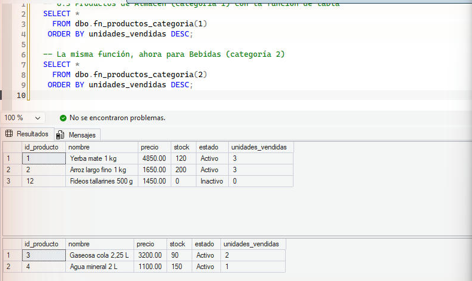

#### Comparación de eficiencia

**Inserción.** Se midieron 1000 `INSERT` directos contra 1000 llamadas a `sp_cliente_insertar`, 3 rondas por ejecución, cada ronda dentro de una transacción que se deshace al final. El script se ejecutó 3 veces (milisegundos por cada 1000 inserciones):

| Ejecución | Ronda 1 directo / SP | Ronda 2 directo / SP | Ronda 3 directo / SP | Promedio directo / SP |
|---|---|---|---|---|
| 1 | 419 / 538 | 1999 / 729 | 218 / 895 | 878 / 720 |
| 2 | 376 / 1181 | 186 / 1177 | 334 / 1943 | 298 / 1433 |
| 3 | 435 / 485 | 369 / 709 | 559 / 426 | 454 / 540 |

Tomando las 9 rondas, la mediana fue de **376 ms para el `INSERT` directo y 729 ms para el procedimiento**. El procedimiento fue más lento en 7 de las 9 rondas. Las mediciones varían bastante entre una ronda y otra (por ejemplo, la ronda 2 de la primera ejecución dio 1999 ms en el directo) porque dependen del disco y de lo que esté haciendo la PC en ese momento.

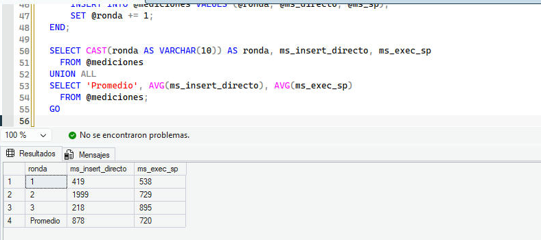

**Consulta.** El total por venta calculado con `fn_total_venta` contra el mismo cálculo con `JOIN` y `GROUP BY`, con `SET STATISTICS TIME ON`. Con 9 ventas los dos tardan 0 ms de CPU y 1 a 2 ms en total: no hay diferencia medible.

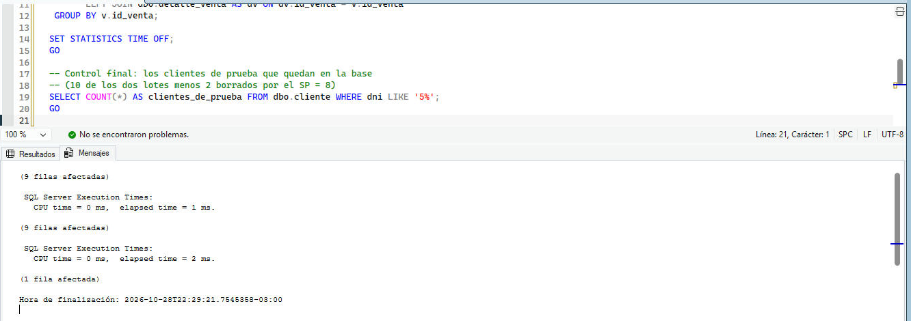

### Conclusiones

- Los procedimientos centralizan las reglas del negocio. El DNI repetido y el cliente con ventas se controlan siempre, sin depender de quien escriba la sentencia, y el error que se muestra es claro.
- En nuestra prueba **el procedimiento no fue más rápido** que el `INSERT` directo: fue un poco más lento, porque además de insertar hace una consulta para validar el DNI y tiene el costo de la llamada. Es una diferencia de menos de medio milisegundo por inserción. La ventaja de usarlo está en la validación, la reutilización y la seguridad, no en la velocidad.
- Las funciones evitan repetir cálculos. El total de una venta, que es un atributo derivado, se obtiene siempre igual con `fn_total_venta`.
- Una función escalar se ejecuta una vez por cada fila. Con 9 ventas no se nota, pero con muchas filas un `JOIN` con `GROUP BY` suele ser más eficiente. Por eso la función conviene para consultas puntuales (una venta o un cliente) y el `JOIN` para reportes grandes.
- La diferencia práctica entre los dos: el procedimiento puede modificar datos y se llama con `EXEC`; la función no puede modificar datos y se usa dentro de una consulta.

---

## Tema 2 — Manejo de transacciones

## 1. Definición Y Objetivo

Una transacción es un conjunto de operaciones SQL que se ejecutan como una única 
unidad lógica de trabajo. El objetivo principal es garantizar la atomicidad, 
consistencia, aislamiento y durabilidad (propiedades ACID), asegurando que 
si una operación intermedia falla, todas las anteriores se desechen mediante un 
`ROLLBACK`, evitando información incompleta o estados inconsistentes.

## 2. Ventajas y Apliccaciónes

- Garantiza la integridad referencial y de negocio al procesar operaciones complejas.
- Evita registros parciales (por ejemplo, guardar una venta sin descontar el stock 
  o generar un detalle sin cabecera).
- Aplicación crítica: Procesamiento de ventas comerciales, control de stock en 
  tiempo real y gestión de pagos.

## 3. IMPLEMENTACIÓN EN SQL SERVER EXPRESS

Script: `sql/tecnico/02_transacciones.sql`.

| Objeto | Tipo | Qué hace |
|---|---|---|
| `BEGIN TRANSACTION / SET XACT_ABORT ON` | Inicio de Transacción | Da inicio formal a la unidad lógica de trabajo y configura el comportamiento del motor ante errores graves. |
| `SELECT ... WITH (UPDLOCK)` | Consulta con Bloqueo | Consulta el stock y el precio actual del producto aplicando un bloqueo de actualización para proteger la concurrencia. |
| `INSERT INTO venta` | Operación de Inserción (Cabecera) | Registra la cabecera de la venta comercial vinculada al cliente y genera el identificador único. |
| `INSERT INTO detalle_venta` | Operación de Inserción (Detalle) | Registra los ítems específicos de la venta, guardando la cantidad y el precio histórico del producto. |
| `UPDATE producto` | Operación de Actualización | Descuenta de forma automática las unidades adquiridas del stock disponible del producto. |
| `COMMIT TRANSACTION` | Confirmación (Commit) | Guarda y persiste de manera definitiva todos los cambios en la base de datos al completarse con éxito |
| `ROLLBACK TRANSACTION` | Reversión (Rollback) |Deshace todos los cambios realizados si el stock es insuficiente o surge un error, garantizando la atomicidad. |

## 4. CASO CONCRETO APLICADO AL SISTEMA DE VENTAS

Escenario: Un cliente realiza la compra de productos en el supermercado. 
La transacción debe ejecutar de forma atómica lo siguiente:
1. Validar que el producto tenga stock suficiente.
2. Registrar la cabecera de la venta en la tabla `venta`.
3. Registrar el ítem comercial en la tabla `detalle_venta`.
4. Descontar las unidades adquiridas del stock en la tabla `producto.]
Si el stock es insuficiente o ocurre un fallo, se cancela y revierte toda la operación.

## 5. SCRIPT DE DEMOSTRACIÓN Y CASOS DE PRUEBA.

La transacción ejecuta de forma atómica el registro de la cabecera de la venta, la inserción del detalle comercial y el descuento correspondiente en el inventario, confirmando y persistiendo todos los cambios de manera exitosa mediante un COMMIT TRANSACTION

Consulta el inventario actual aplicando un bloqueo de lectura segura y evalúa si la cantidad solicitada supera lo disponible. Si no hay stock, genera un error y aborta el flujo antes de modificar ninguna tabla.

Inserta el registro principal en la tabla venta para dar de alta la operación comercial y captura su identificador único para vincular los ítems

Inserta los productos específicos que componen la venta en la tabla detalle_venta, registrando la cantidad y el precio histórico del momento.

Resta de forma automática las unidades adquiridas del inventario general en la tabla

Si las operaciones anteriores se completan con éxito, este bloque hace permanentes los cambios en la base de datos.

Si ocurre cualquier fallo o la validación de stock inicial no se cumple, el bloque CATCH intercepta el error y ejecuta el ROLLBACK para deshacer absolutamente todo lo hecho en los pasos 2, 3 y 4, garantizando que no queden datos parciales.

Al intentar registrar una venta con una cantidad que excede el stock disponible, la validación interna detecta el fallo y ejecuta automáticamente un ROLLBACK TRANSACTION. Esto revierte por completo todas las operaciones intermedias, garantizando que no se registre la venta, no se cree el detalle y el stock permanezca intacto sin dejar información parcial o inconsistente

## Conclusiones

- La implementación del manejo de transacciones asegura que operaciones críticas del negocio —como el registro de una venta y la modificación del stock— funcionen como una única unidad lógica indivisible, cumpliendo rigurosamente con las propiedades ACID del motor de base de datos.   

- A través de las pruebas de ejecución se comprobó de forma empírica que, ante fallos de validación (como la falta de stock suficiente), el bloque de control revierte de manera automática todos los cambios parciales mediante un ROLLBACK, evitando estados inconsistentes o registros huérfanos en el sistema. 

- Centralizar la lógica transaccional dentro de procedimientos almacenados robustece la aplicación, previniendo alteraciones accidentales del inventario y blindando la base de datos frente a errores operativos o de concurrencia.   
## Tema 3 — Triggers de auditoría

### 1. Definición y objetivo

Un **trigger** (desencadenador) es código SQL guardado en la base que el motor ejecuta **solo**, sin que nadie lo llame, cuando ocurre un evento sobre una tabla: `INSERT`, `UPDATE` o `DELETE`.

- Un trigger **`AFTER`** se ejecuta después de que la operación se hizo bien.
- Un trigger **`INSTEAD OF`** se ejecuta **en lugar** de la operación, así que puede impedirla.
- Dentro del trigger hay dos tablas virtuales: `deleted` tiene las filas como estaban antes, e `inserted` como quedaron. En un `UPDATE` están las dos; en un `DELETE`, solo `deleted`.

El objetivo de un trigger de **auditoría** es dejar registrado automáticamente quién cambió qué y cuándo, sin depender de que la aplicación o el usuario lo anote.

### 2. Ventajas y aplicaciones

- **Trazabilidad:** responden preguntas como quién cambió un precio, cuándo se borró un producto y qué valor tenía antes.
- **No se pueden saltear:** se ejecutan siempre, venga la modificación de donde venga (la aplicación, SSMS o un procedimiento).
- **Protegen reglas del negocio** que una restricción común no cubre, como impedir el borrado de comprobantes fiscales.
- **Costo:** cada operación sobre la tabla hace trabajo extra (una fila más en la auditoría), y la lógica queda "escondida" en la tabla, por eso conviene documentarlos.

### 3. Implementación en SQL Server Express

Script: `sql/tecnico/03_triggers.sql`.

| Objeto | Tipo | Qué hace |
|---|---|---|
| `dbo.auditoria_producto` | Tabla auxiliar | Guarda la copia completa de la fila de `producto` antes del cambio, el precio y el stock nuevos (en los `UPDATE`), la operación, la fecha y hora (`SYSDATETIME()`) y el usuario de la base (`SUSER_SNAME()`) |
| `dbo.trg_producto_auditoria_update` | Trigger `AFTER UPDATE` sobre `producto` | Por cada fila modificada inserta una fila en la auditoría con los valores anteriores y los nuevos |
| `dbo.trg_producto_auditoria_delete` | Trigger `AFTER DELETE` sobre `producto` | Por cada fila borrada inserta una fila en la auditoría con todos sus valores |
| `dbo.trg_factura_no_borrar` | Trigger `INSTEAD OF DELETE` sobre `factura` | Muestra el mensaje «Operación no permitida: las facturas emitidas no se pueden borrar.» (error 50010) y no borra nada |

Decisiones:

- La tabla de auditoría **no tiene FK a `producto`** a propósito: tiene que conservar los datos de un producto aunque se borre.
- Los triggers trabajan con **conjuntos de filas** (`INSERT ... SELECT ... FROM deleted`), no con variables. Así, si un `UPDATE` cambia varios productos a la vez, se audita cada uno.
- El bloqueo de borrado se hizo sobre `factura` porque una factura emitida es un comprobante fiscal (RN08). Además, `INSTEAD OF DELETE` no se puede crear en tablas que tienen una FK con `ON DELETE CASCADE` (`detalle_venta`, `venta_pago`), y `factura` no la tiene.
- Las pruebas usan dos **productos de prueba**, para no cambiar los precios ni el stock de los productos reales que usan las consultas de la Etapa IV.
- El script se puede ejecutar más de una vez: al principio apaga los triggers, borra los productos de prueba anteriores y los vuelve a encender.

### 4. Caso concreto en el supermercado

- Si un día la yerba aparece a otro precio, el encargado consulta `auditoria_producto` y ve el precio anterior, el nuevo, el usuario y la hora del cambio.
- Si se da de baja un producto, queda guardado cómo estaba (precio, stock, categoría) aunque ya no exista en `producto`.
- Los descuentos de stock también quedan registrados. Por ejemplo, cada venta que registra la transacción del tema 2 deja en la auditoría el stock anterior y el nuevo del producto vendido.
- Nadie puede borrar una factura, ni por error ni a propósito, aunque tenga permisos para escribir el `DELETE`.

### 5. Demostración y resultados

**Triggers creados.** Los tres triggers aparecen activos en `sys.triggers`, con su tabla, su tipo y su evento.

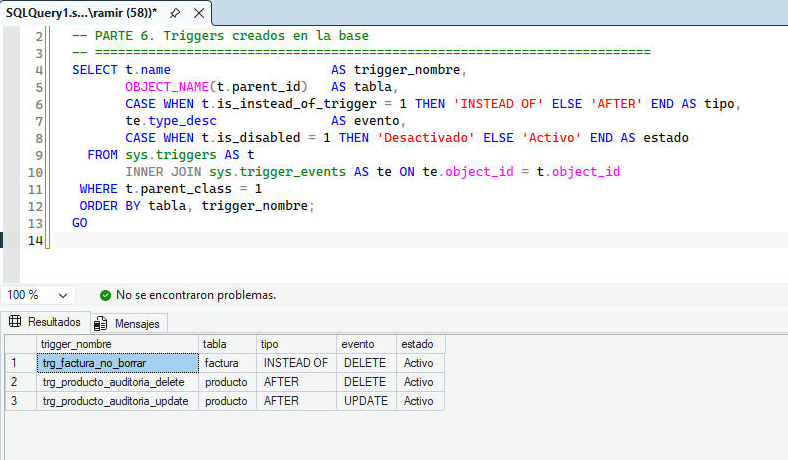

**Auditoría de modificaciones y borrados.** Se cargaron dos productos de prueba (café a 6200 y jugo a 1800) y se hicieron cuatro operaciones:

| Operación | Filas auditadas | Qué quedó registrado |
|---|---|---|
| Cambio de precio del café a 6900 | 1 | 6200 → 6900 |
| Aumento del 10 % a los dos productos en un solo `UPDATE` | 2 | Café 6900 → 7590 y jugo 1800 → 1980 |
| Venta de 5 jugos | 1 | Stock 45 → 40 (el precio no cambia) |
| Baja del jugo | 1 | `DELETE` con todos sus datos: precio 1980 y stock 40 |

En total, 5 filas, cada una con la fecha y hora y el usuario `FABRIPC\ramir`. La fila del `DELETE` tiene `precio_nuevo` y `stock_nuevo` en `NULL` porque el producto ya no existe.

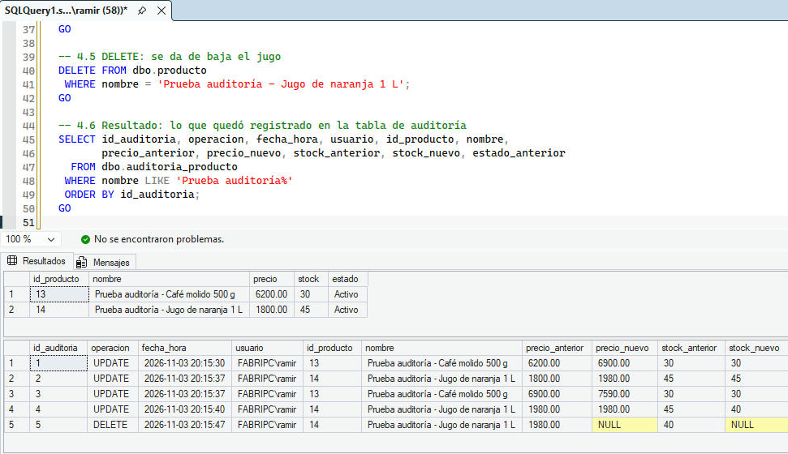

**Un borrado que falla no se audita.** Se intenta borrar la yerba (producto 1), que tiene proveedor y ventas. La FK `FK_producto_proveedor_producto` frena el `DELETE` (error 547) y, como el trigger es `AFTER`, no llega a ejecutarse: la auditoría tiene 5 filas antes y 5 después.

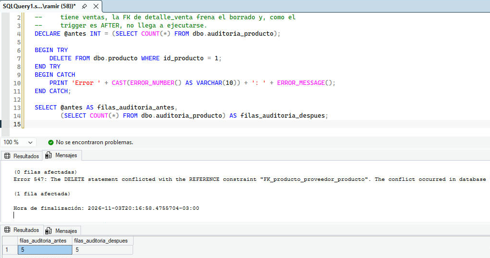

**Trigger que impide borrar facturas.** Se intenta borrar la factura 9 y después todas las facturas tipo B. Las dos veces aparece el error 50010 con el mensaje del trigger, la factura 9 sigue estando y la base sigue teniendo 9 facturas.

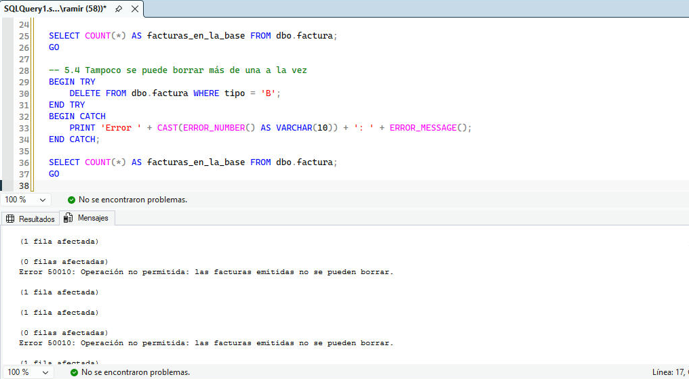

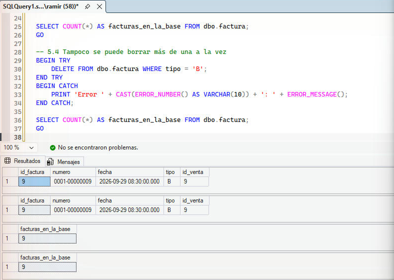

El script se ejecutó dos veces seguidas de punta a punta, sin errores salvo los que se provocan a propósito.

### Conclusiones

- Los triggers de auditoría registran cada cambio sin que nadie tenga que acordarse de hacerlo: quedó guardado el valor anterior, el nuevo, el usuario y la hora de cada modificación y de cada borrado.
- Hay que escribirlos para varias filas. El aumento del 10 % cambió dos productos con una sola sentencia y el trigger guardó las dos filas; con variables sueltas se habría perdido una.
- Un trigger `AFTER` solo se ejecuta si la operación salió bien: si una FK frena el borrado, no queda ninguna fila en la auditoría, que es lo correcto porque no cambió nada.
- El trigger `INSTEAD OF` sirve para reglas que las restricciones no cubren. Ni `CHECK` ni `FOREIGN KEY` pueden impedir que se borre una factura; el trigger sí, y además devuelve un mensaje claro.
- La contra es que cada `UPDATE` o `DELETE` sobre `producto` hace una inserción más, y que la tabla de auditoría crece siempre. En un sistema real habría que definir cada cuánto se archiva.

---

## Tema 4 — Seguridad: permisos de usuarios y roles

## Tema 4 — Seguridad: permisos de usuarios y roles (Víctor López Machado)

### 1. Definición y objetivo

La seguridad en SQL Server permite controlar quién puede acceder a una base de datos y qué operaciones puede realizar sobre sus objetos, como tablas y procedimientos almacenados.

Para administrar estos accesos se utilizan tres elementos principales:

- **Logins:** identifican a los usuarios que pueden autenticarse en el servidor SQL Server.
- **Usuarios:** representan las identidades asociadas a una base de datos específica.
- **Roles:** agrupan usuarios y permiten administrar sus permisos de manera centralizada.

El objetivo de esta implementación es establecer diferentes niveles de acceso para los perfiles del supermercado, evitando que todos los usuarios puedan consultar, insertar o modificar libremente la información.

Se aplica el principio de mínimo privilegio: cada usuario recibe únicamente los permisos necesarios para cumplir sus funciones.

### 2. Ventajas y aplicaciones

- **Control de acceso:** permite definir qué usuarios pueden consultar o modificar la información.
- **Separación de responsabilidades:** diferencia las operaciones del personal de caja de las tareas de auditoría.
- **Protección de datos:** impide modificaciones o inserciones no autorizadas.
- **Seguridad mediante roles:** permite administrar permisos para grupos de usuarios sin configurarlos individualmente.
- **Centralización de operaciones:** permite ejecutar procedimientos almacenados autorizados sin conceder acceso directo de escritura sobre las tablas.
- **Mantenimiento:** facilita modificar los permisos de un perfil sin tener que cambiar la configuración de cada usuario.

### 3. Implementación en SQL Server Express

Script: `sql/tecnico/04_seguridad.sql`.

Se crearon dos logins, dos usuarios de base de datos y dos roles personalizados para representar los perfiles de acceso del sistema.

**Usuarios y roles creados:**

| Login | Usuario de base de datos | Rol asignado |
|---|---|---|
| `login_operario` | `usuario_operario` | `rol_cajero` |
| `login_auditor` | `usuario_auditor` | `rol_auditoria` |

La asignación de usuarios a sus respectivos roles se realiza mediante `ALTER ROLE ... ADD MEMBER`.

**Configuración de permisos:**

| Rol | Objeto | Permisos | Finalidad |
|---|---|---|---|
| `rol_cajero` | `producto` | `SELECT` | Consultar productos. |
| `rol_cajero` | `cliente` | `SELECT` | Consultar clientes. |
| `rol_cajero` | `venta` | `SELECT`, `INSERT` | Consultar y registrar ventas. |
| `rol_cajero` | Tabla de detalles de venta | `SELECT`, `INSERT` | Consultar y registrar los productos vendidos. |
| `rol_cajero` | `cliente` | `DENY INSERT` | Impedir inserciones directas de clientes. |
| `rol_cajero` | `dbo.sp_cliente_insertar` | `EXECUTE` | Permitir altas de clientes mediante el procedimiento almacenado. |
| `rol_auditoria` | Tablas principales | `SELECT` | Consultar información sin permisos de escritura. |

Para implementar estas restricciones se utilizaron los siguientes comandos:

- `CREATE LOGIN` y `CREATE USER`: crean las identidades de acceso al servidor y a la base de datos.
- `CREATE ROLE`: define los perfiles personalizados.
- `ALTER ROLE ... ADD MEMBER`: incorpora usuarios a los roles.
- `GRANT`: concede permisos sobre tablas y procedimientos almacenados.
- `DENY`: establece una denegación explícita de permisos.
- `EXECUTE AS USER`: permite simular la identidad de otro usuario para realizar pruebas.
- `REVERT`: restaura el contexto de seguridad original.

Una decisión importante fue utilizar el procedimiento `dbo.sp_cliente_insertar`, desarrollado en el Tema 1, para permitir el registro de clientes sin conceder al cajero permisos de inserción directa sobre la tabla `cliente`.

Esto funciona mediante la cadena de propiedad (*ownership chaining*) de SQL Server: cuando el procedimiento y la tabla pertenecen al mismo propietario, el procedimiento puede realizar la operación sin que el usuario necesite tener directamente el permiso `INSERT` sobre la tabla.

### 4. Caso concreto aplicado al sistema de ventas

En el supermercado existen diferentes responsabilidades y no todos los empleados necesitan acceder a las mismas operaciones.

- **Cajero u operario:** puede consultar los productos y clientes disponibles, registrar ventas y sus respectivos detalles. Cuando necesita dar de alta un cliente, debe utilizar `sp_cliente_insertar`, en lugar de ejecutar un `INSERT` directamente sobre la tabla.
- **Auditor:** puede consultar productos, clientes, ventas, detalles de venta, proveedores y categorías para revisar la información comercial, pero no tiene permisos de escritura sobre esas tablas.

De esta manera, se evita que un empleado pueda realizar operaciones ajenas a sus responsabilidades y se mantiene un mayor control sobre la información almacenada.

### 5. Demostración y resultados

La validación de seguridad se realiza mediante tres pruebas que simulan diferentes situaciones de acceso utilizando `EXECUTE AS USER` y bloques `TRY...CATCH`.

**Prueba 1 — Bloqueo de inserción directa de clientes.**

Se simula al usuario `usuario_operario` intentando insertar un registro directamente en la tabla `cliente`.

La operación debe ser rechazada por la restricción `DENY INSERT` asignada al rol `rol_cajero`. El bloque `CATCH` captura el error y muestra el mensaje correspondiente.

**Prueba 2 — Inserción autorizada mediante procedimiento almacenado.**

Se vuelve a simular al usuario `usuario_operario`, pero esta vez se ejecuta `dbo.sp_cliente_insertar` con los parámetros correspondientes al DNI, nombre, apellido, teléfono y email.

La operación debe completarse correctamente gracias al permiso `GRANT EXECUTE` otorgado al rol `rol_cajero`, demostrando que el usuario puede registrar clientes mediante el mecanismo autorizado sin disponer de inserción directa sobre la tabla.

**Prueba 3 — Restricción de escritura para el auditor.**

Se simula al usuario `usuario_auditor` intentando insertar un registro en la tabla `categoria`.

La operación debe ser rechazada porque el rol `rol_auditoria` solamente cuenta con permisos de lectura (`SELECT`) y no dispone de autorización para insertar información.

### Conclusiones

- La implementación de usuarios y roles permite establecer diferentes niveles de acceso según las responsabilidades de cada perfil dentro del supermercado.
- El principio de mínimo privilegio reduce los riesgos de modificaciones accidentales o accesos no autorizados.
- La combinación de `GRANT` y `DENY` permite controlar de manera precisa las operaciones disponibles para cada rol.
- La utilización de `GRANT EXECUTE` sobre un procedimiento almacenado permite centralizar las operaciones de inserción y mantener restringido el acceso directo a las tablas.
- Las pruebas con `EXECUTE AS USER` permitieron definir escenarios para comprobar que las operaciones autorizadas se ejecuten correctamente y que las restringidas sean rechazadas.

En conclusión, los mecanismos de seguridad implementados complementan los procedimientos almacenados del Tema 1 y permiten construir una base de datos más segura, organizada y controlada.

## Tema 5 — Optimización de consultas con índices

_A completar._
