# Etapa V — Temas técnicos

**¿Cómo hacemos la solución más robusta?**

En esta etapa usamos mecanismos del motor de SQL Server Express sobre la base `supermercado` de la Etapa III: procedimientos y funciones almacenadas, transacciones, triggers de auditoría, permisos y roles, e índices. Para cada tema se documenta para qué sirve, por qué lo elegimos, cómo se integra al sistema y cómo se demuestra que funciona.

## Orden de ejecución

Primero se ejecutan los scripts de la Etapa III (ver `docs/etapa-03/README.md`). Después, los de `sql/tecnico/` en orden, porque el tema 4 usa el procedimiento de inserción del tema 1:

| Tema | Script | Capturas |
|---|---|---|
| 1. Procedimientos y funciones almacenadas | `sql/tecnico/01_procedimientos_funciones.sql` | `t1-*.png` |
| 2. Manejo de transacciones | `sql/tecnico/02_transacciones.sql` | `t2-*.png` |
| 3. Triggers de auditoría | `sql/tecnico/03_triggers.sql` | `t3-*.png` |
| 4. Seguridad: permisos de usuarios y roles | `sql/tecnico/04_seguridad.sql` | `t4-*.png` |
| 5. Optimización de consultas con índices | `sql/tecnico/05_indices.sql` | `t5-*.png` |

---

## Tema 1 — Procedimientos y funciones almacenadas (Ramiro Yunes)

### 1. Definición y objetivo

Un **procedimiento almacenado** es un conjunto de sentencias SQL guardado dentro de la base con un nombre. Recibe parámetros, puede hacer `INSERT`, `UPDATE` y `DELETE`, y se ejecuta con `EXEC`.

Una **función almacenada** recibe parámetros y devuelve un resultado: un valor (función escalar) o una tabla (función con valor de tabla). **No puede modificar datos**, y por eso se puede usar dentro de un `SELECT`, en el `WHERE` o en el `FROM`.

El objetivo es escribir una sola vez la lógica que se repite (dar de alta un cliente, calcular el total de una venta) y que toda la aplicación la use de la misma forma.

### 2. Ventajas y aplicaciones

- **Reutilización:** la lógica se escribe una vez y se llama desde cualquier lado.
- **Reglas de negocio centralizadas:** por ejemplo, «un cliente con compras no se borra» queda dentro del procedimiento y no depende de quien escriba el `DELETE`.
- **Seguridad:** se puede dar permiso para ejecutar un procedimiento sin dar permiso sobre la tabla (es lo que se demuestra en el tema 4).
- **Mantenimiento:** si cambia la regla, se cambia en un solo lugar.
- **Funciones para datos derivados:** el total de una venta no se guarda en ninguna tabla (es un atributo derivado); una función lo calcula siempre igual.

### 3. Implementación en SQL Server Express

Script: `sql/tecnico/01_procedimientos_funciones.sql`.

| Objeto | Tipo | Qué hace |
|---|---|---|
| `dbo.sp_cliente_insertar` | Procedimiento | Da de alta un cliente. Rechaza un DNI repetido con un mensaje propio (error 50001) y devuelve el id generado en un parámetro `OUTPUT` |
| `dbo.sp_cliente_modificar` | Procedimiento | Cambia nombre, apellido, teléfono y email de un cliente. Si el id no existe, error 50002 |
| `dbo.sp_cliente_borrar` | Procedimiento | Borra un cliente. Si tiene ventas no lo deja borrar (error 50003) |
| `dbo.fn_total_venta(@id_venta)` | Función escalar | Total de una venta: suma de los subtotales de `detalle_venta` |
| `dbo.fn_descuento_cliente(@id_cliente)` | Función escalar | Porcentaje de descuento según lo que compró el cliente |
| `dbo.fn_productos_categoria(@id_categoria)` | Función con valor de tabla | Productos de una categoría con sus unidades vendidas |

Elegimos la tabla **`cliente`** para los procedimientos porque los clientes nuevos no tienen ventas: se pueden insertar, modificar y borrar sin chocar con la FK de `venta`.

La función de descuento se basa en el ejemplo de la guía de la cátedra. Los montos se adaptaron a la escala de nuestros datos de prueba, porque con los de la guía (500.000 y 200.000) ningún cliente tendría descuento:

| Total acumulado del cliente | Descuento |
|---|---|
| 12.000 o más | 10 % |
| 8.000 o más | 5 % |
| Menos de 8.000 | 0 % |

El script se puede ejecutar más de una vez: los objetos se crean con `CREATE OR ALTER`, y al principio se borran los clientes de prueba (DNI que empiezan con 5).

### 4. Caso concreto en el supermercado

- En la caja se da de alta un cliente nuevo con `sp_cliente_insertar`. Si el DNI ya estaba cargado, el sistema avisa en vez de mostrar un error técnico de SQL.
- Atención al cliente actualiza teléfono y email con `sp_cliente_modificar`.
- Si alguien intenta borrar un cliente que ya compró, `sp_cliente_borrar` lo impide: sus ventas y facturas tienen que quedar en el historial.
- Para el ticket o cualquier reporte, `fn_total_venta` da el total de una venta. Es el mismo cálculo que hicimos con `SUM` en el CU01 de la Etapa IV.
- `fn_descuento_cliente` dice qué descuento le corresponde a un cliente frecuente.
- `fn_productos_categoria` sirve para ver una góndola: qué productos hay en la categoría, su stock y cuánto se vendió.

### 5. Demostración y resultados

**Objetos creados.** En el Explorador de objetos aparecen los 3 procedimientos, las 2 funciones escalares y la función con valor de tabla.

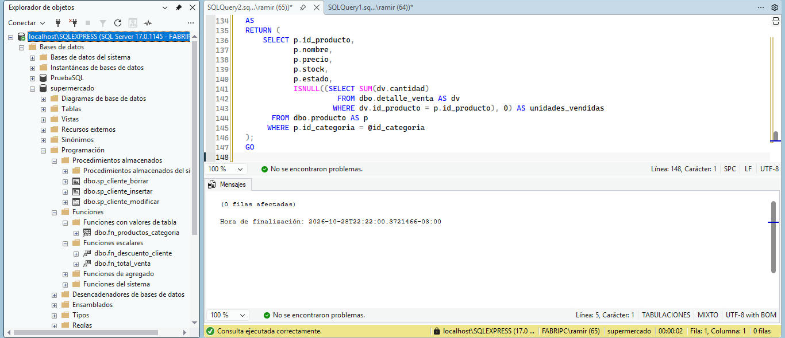

**Lote con `INSERT` directo.** Cinco clientes cargados con una sentencia `INSERT` (ids 11 a 15).

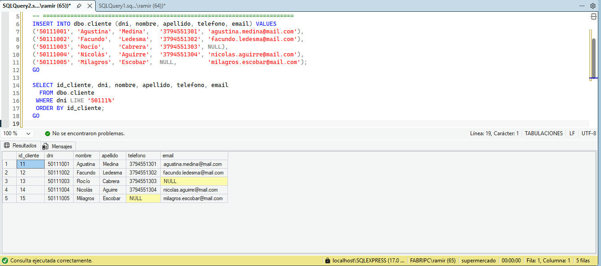

**Lote invocando el procedimiento.** Otros cinco clientes cargados con `EXEC dbo.sp_cliente_insertar` (ids 16 a 20). Cada llamada devuelve el id generado. Al final se intenta cargar un DNI repetido y el procedimiento lo rechaza con el error 50001.

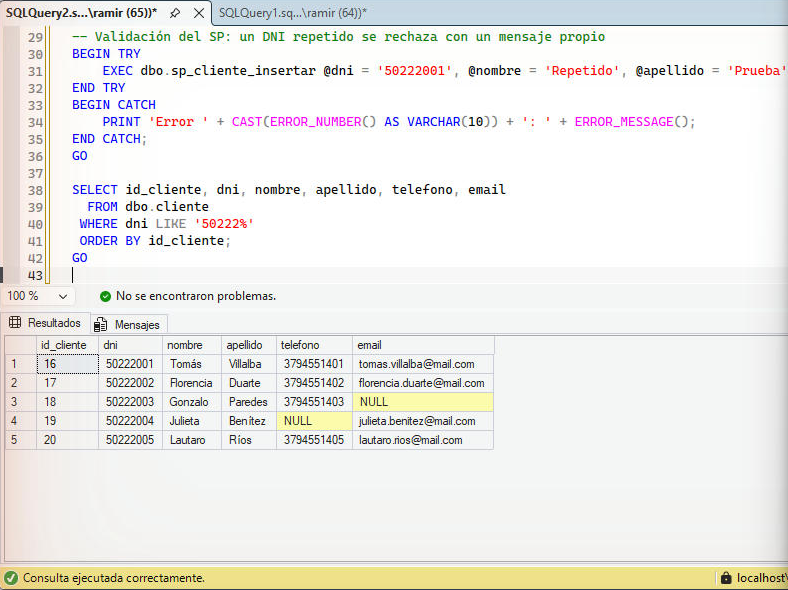

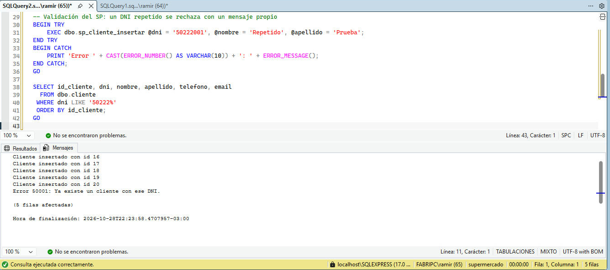

**`UPDATE` y `DELETE` con los procedimientos.** Antes y después: a Rocío Cabrera (13) y a Gonzalo Paredes (18) se les completaron los datos de contacto, y Milagros Escobar (15) y Julieta Benítez (19) se borraron. Después se intenta borrar al cliente 1, que tiene ventas, y el procedimiento lo impide con el error 50003.

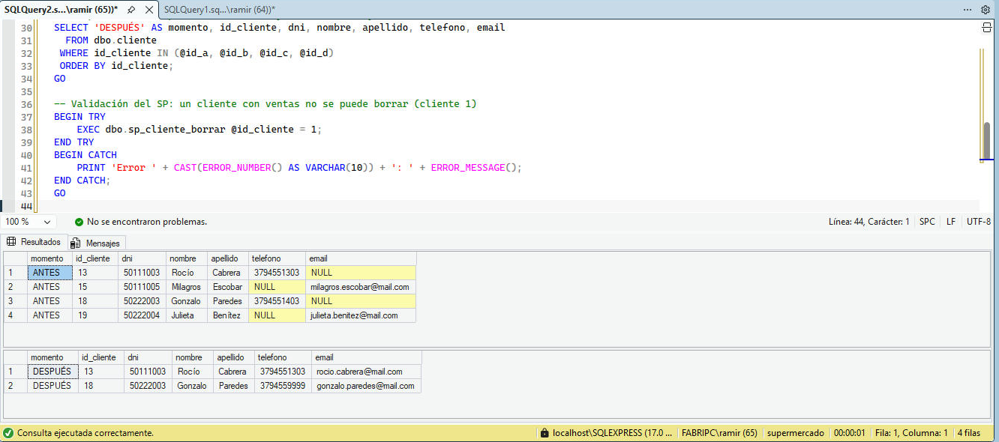

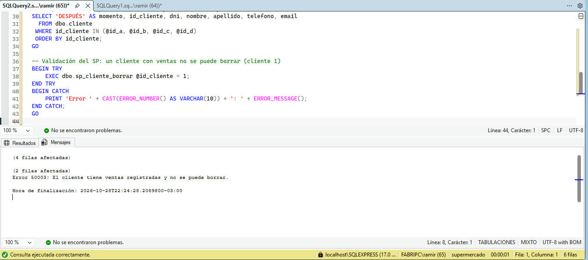

**Función `fn_total_venta`.** Total de las 9 ventas. La suma da 70.800, igual que en la Etapa IV.

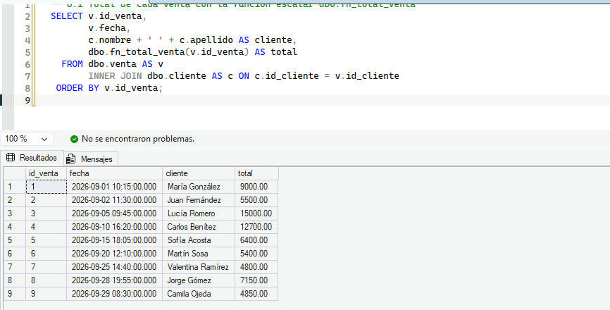

**Función `fn_descuento_cliente`.** Lucía Romero (15.000) y Carlos Benítez (12.700) tienen 10 %, María González (9.000) tiene 5 % y el resto 0 %.

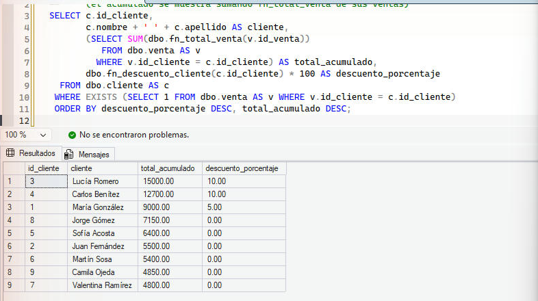

**Función `fn_productos_categoria`.** Se usa en el `FROM` como si fuera una tabla, con la categoría 1 (Almacén) y la 2 (Bebidas).

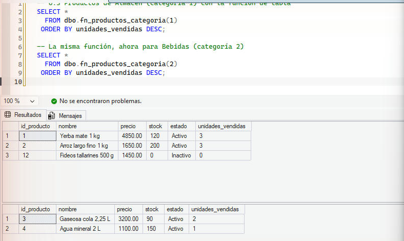

#### Comparación de eficiencia

**Inserción.** Se midieron 1000 `INSERT` directos contra 1000 llamadas a `sp_cliente_insertar`, 3 rondas por ejecución, cada ronda dentro de una transacción que se deshace al final. El script se ejecutó 3 veces (milisegundos por cada 1000 inserciones):

| Ejecución | Ronda 1 directo / SP | Ronda 2 directo / SP | Ronda 3 directo / SP | Promedio directo / SP |
|---|---|---|---|---|
| 1 | 419 / 538 | 1999 / 729 | 218 / 895 | 878 / 720 |
| 2 | 376 / 1181 | 186 / 1177 | 334 / 1943 | 298 / 1433 |
| 3 | 435 / 485 | 369 / 709 | 559 / 426 | 454 / 540 |

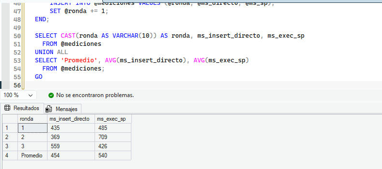

Tomando las 9 rondas, la mediana fue de **376 ms para el `INSERT` directo y 729 ms para el procedimiento**. El procedimiento fue más lento en 7 de las 9 rondas. Las mediciones varían bastante entre una ronda y otra (por ejemplo, la ronda 2 de la primera ejecución dio 1999 ms en el directo) porque dependen del disco y de lo que esté haciendo la PC en ese momento.

**Consulta.** El total por venta calculado con `fn_total_venta` contra el mismo cálculo con `JOIN` y `GROUP BY`, con `SET STATISTICS TIME ON`. Con 9 ventas los dos tardan 0 ms de CPU y 1 a 2 ms en total: no hay diferencia medible.

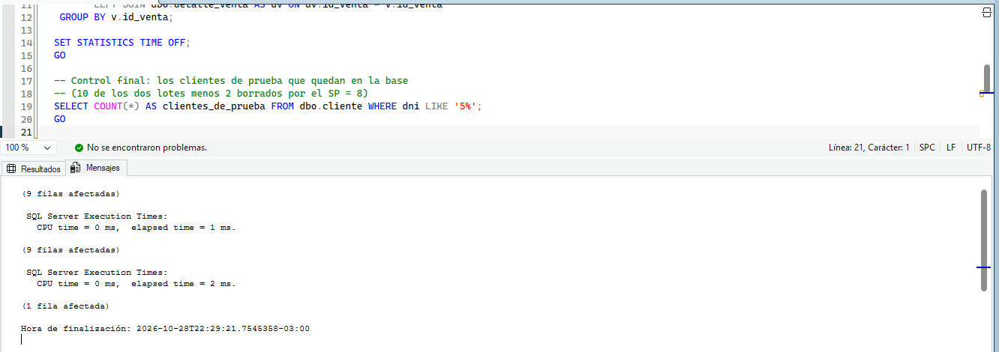

### Conclusiones

- Los procedimientos centralizan las reglas del negocio. El DNI repetido y el cliente con ventas se controlan siempre, sin depender de quien escriba la sentencia, y el error que se muestra es claro.
- En nuestra prueba **el procedimiento no fue más rápido** que el `INSERT` directo: fue un poco más lento, porque además de insertar hace una consulta para validar el DNI y tiene el costo de la llamada. Es una diferencia de menos de medio milisegundo por inserción. La ventaja de usarlo está en la validación, la reutilización y la seguridad, no en la velocidad.
- Las funciones evitan repetir cálculos. El total de una venta, que es un atributo derivado, se obtiene siempre igual con `fn_total_venta`.
- Una función escalar se ejecuta una vez por cada fila. Con 9 ventas no se nota, pero con muchas filas un `JOIN` con `GROUP BY` suele ser más eficiente. Por eso la función conviene para consultas puntuales (una venta o un cliente) y el `JOIN` para reportes grandes.
- La diferencia práctica entre los dos: el procedimiento puede modificar datos y se llama con `EXEC`; la función no puede modificar datos y se usa dentro de una consulta.

---

## Tema 2 — Manejo de transacciones

_A completar._

---

## Tema 3 — Triggers de auditoría

_A completar._

---

## Tema 4 — Seguridad: permisos de usuarios y roles

_A completar. Usar `dbo.sp_cliente_insertar` del tema 1 para la prueba de permiso de ejecución._

---

## Tema 5 — Optimización de consultas con índices

_A completar._
